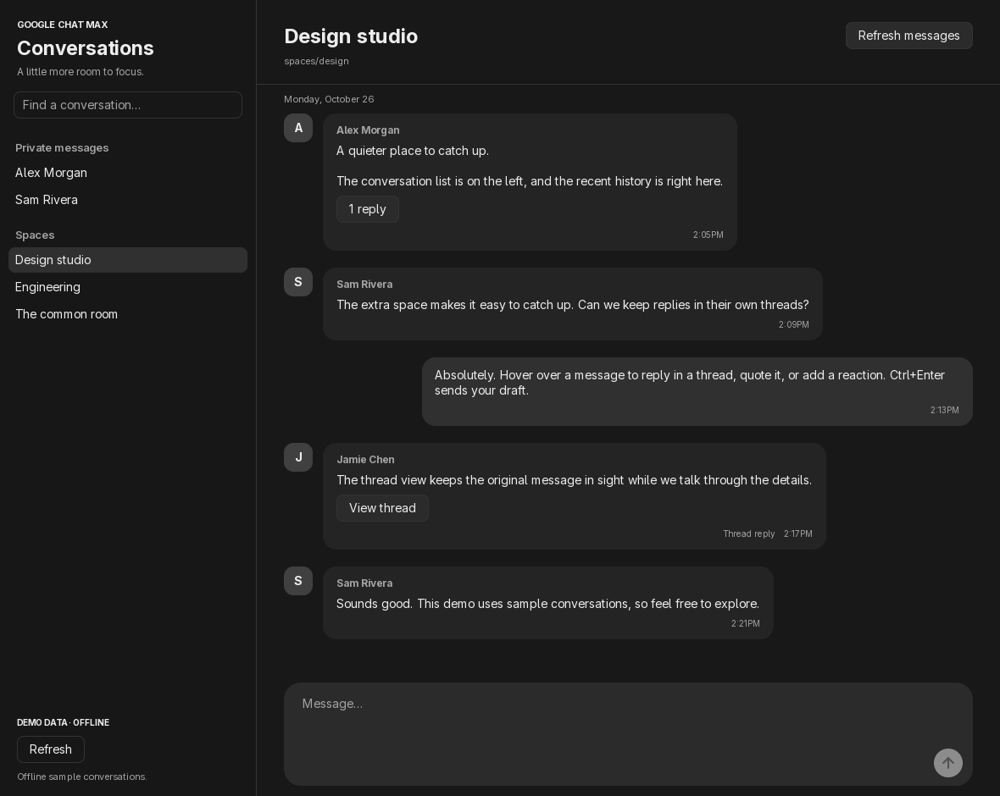

# Google Chat Max

A native Google Chat desktop client built in Go with `github.com/egoist/mygo/ui`.
The interface uses no webview, HTML frontend, or embedded Chat website.

> **Experimental · Linux x86-64.** This is an independent desktop client, unaffiliated
> with Google. Expect rough edges. Sleep/wake, overnight use, long outages, and
> real-account sends/reactions still need broader validation. Drafts last only
> for the current session. Opening a configured app starts live delivery and
> creates cloud resources that may incur charges.



*Native app view rendered with offline demo data. Names and messages are synthetic.*

## Install and try the demo

### Download a Linux binary

Once a version has been released, open this repository's **Releases** page and
choose an experimental prerelease. Download the `linux-amd64.tar.gz` archive and
its matching `.sha256` file. Linux x86-64 with glibc 2.35 or newer is the release
target; ARM and other operating systems do not have release packages yet.

In the download directory, replace `VERSION` with that release's tag:

```sh
sha256sum -c google-chat-max-VERSION-linux-amd64.tar.gz.sha256
tar -xzf google-chat-max-VERSION-linux-amd64.tar.gz
cd google-chat-max-VERSION-linux-amd64
./google-chat-max -demo
```

The checksum must report `OK` before extraction. Demo mode needs no Google login
or Cloud project, makes no Google calls, and sends nothing to real conversations.
The archive includes this guide, dependency license notices, and `BUILD.txt` with
the source revision and Go build details.

### Linux runtime dependencies

Use a graphical Linux desktop with GTK 3, GLib/GIO, Cairo, GDK Pixbuf, Fontconfig,
and fonts installed. Emoji rendering depends on your system emoji font.
For example, on Ubuntu 22.04:

```sh
sudo apt-get update
sudo apt-get install libgtk-3-0 libfontconfig1 libepoxy0 fonts-noto-color-emoji
```

On Arch Linux:

```sh
sudo pacman -S --needed gtk3 fontconfig libepoxy noto-fonts-emoji
```

GTK pulls in the GLib, Cairo, and GDK Pixbuf libraries. MyGo loads the native
libraries at runtime; a successful compilation alone does not prove that they
are installed. This app uses native MyGo widgets without a webview.

### Build from source

Install [Go](https://go.dev/dl/) 1.27.3+ and a C compiler (`build-essential` on
Ubuntu, or `base-devel` on Arch). From the repository root:

```sh
GOMAXPROCS=6 go build -mod=readonly -tags=netcgo -p 6 -o bin/google-chat-max ./cmd/google-chat-max
./bin/google-chat-max -demo
```

Go can download its required toolchain automatically. The `netcgo` build uses the
system DNS resolver on Linux and respects an explicit `GODEBUG=netdns=...`
override. Python 3 is only needed for the development packaging/relaunch helpers
and emoji-catalog regeneration.

## Set up your Google account

Real-account access currently uses your own Google Cloud project, Desktop OAuth
client, and saved Google Workspace CLI login. No shared OAuth client or service
account is bundled. Use the same Cloud project for the OAuth client and the app's
live-delivery resources. You need access to Google Chat and the conversations you
want to read; a managed Workspace account may require administrator approval for
OAuth access or API use. Custom emoji additionally require Workspace and must be
enabled by your administrator ([Google's requirements](https://developers.google.com/workspace/chat/api/reference/rest/v1/customEmojis/list)).

### 1. Install the Google tools

Install the [Google Cloud CLI](https://cloud.google.com/sdk/docs/install) (`gcloud`)
and the [Google Workspace CLI](https://github.com/googleworkspace/cli) (`gws`).
The latter offers prebuilt binaries; with Node.js 18+ and npm, you can also use:

```sh
npm install -g @googleworkspace/cli
gcloud version
gws --version
```

Both commands must be available on the app's `PATH`. After initial setup,
`gcloud` is optional; the app still needs `gws` to load the saved user OAuth login.

### 2. Prepare a dedicated Cloud project

Create or select a project in [Google Cloud Console](https://console.cloud.google.com/),
attach billing, and note its **project ID** (not the display name or project
number). A dedicated project makes app-created resources easier to identify.
Sign in with the account that can administer it, replacing `your-project-id`:

```sh
gcloud auth login
gcloud services enable chat.googleapis.com workspaceevents.googleapis.com pubsub.googleapis.com \
  --project=your-project-id
gws auth setup --project your-project-id
```

The setup wizard can change the selected project's configuration. Review its
prompts and use an existing project explicitly rather than accepting an
unintended new one. In the Chat API configuration page, fill in the app name,
avatar URL, and description as required by
[Google's subscription setup guide](https://developers.google.com/workspace/events/guides/create-subscription).
The desktop app creates its own topic and subscriptions; do not create a second
listener from Google's sample code.

For manual OAuth setup, use **Google Auth Platform** in the same project:
configure Branding and Audience, select an audience permitted for your account,
and add yourself as a test user for an External app in Testing. Create a
**Desktop app** OAuth client and save its downloaded JSON to
`~/.config/gws/client_secret.json` (or the directory specified by
`GOOGLE_WORKSPACE_CLI_CONFIG_DIR`). Keep the file outside this repository and
restrict it to your user. The
[upstream manual setup instructions](https://github.com/googleworkspace/cli#manual-oauth-setup-google-cloud-console)
cover the Console steps. `gcloud auth login` and `gws auth login` are separate
logins; signing into `gcloud` alone does not authenticate this app.

### 3. Grant Cloud permissions

The account used for the app's `gws` login needs permission to create and clean
up its own Pub/Sub resources in the selected project. An administrator can use a
custom IAM role containing these permissions:

```text
pubsub.topics.create
pubsub.topics.get
pubsub.topics.delete
pubsub.topics.setIamPolicy
pubsub.topics.attachSubscription
pubsub.subscriptions.create
pubsub.subscriptions.get
pubsub.subscriptions.delete
pubsub.subscriptions.consume
```

The predefined **Pub/Sub Admin** role (`roles/pubsub.admin`) also covers them,
but grants broader project access. Enabling APIs and configuring OAuth require
additional setup permissions; those operations are performed during setup, not
by the running app. See [Google's Pub/Sub IAM reference](https://cloud.google.com/pubsub/docs/access-control).
The app grants `chat-api-push@system.gserviceaccount.com` the Publisher role only
on its newly created topic. It preserves other listeners and uses no
organization-wide event subscription.

### 4. Sign in with the required OAuth scopes

OAuth scopes and Cloud IAM permissions are separate: the login needs both.
Use a custom scope list so you do not request unrelated Workspace services:

```sh
gws auth login --scopes 'openid,https://www.googleapis.com/auth/userinfo.profile,https://www.googleapis.com/auth/chat.spaces.readonly,https://www.googleapis.com/auth/chat.memberships.readonly,https://www.googleapis.com/auth/chat.messages,https://www.googleapis.com/auth/chat.customemojis.readonly,https://www.googleapis.com/auth/pubsub'
gws auth status
```

Approve the requested scopes for the account you intend to use in Chat. Configure
the same scopes under the OAuth client's Data Access settings if prompted.
Do not paste the output of `gws auth export --unmasked` into issues or files.
The app exports credentials directly into process memory when it opens a backend.
It needs a saved OAuth login with a refresh token, rather than an access-token-only
or service-account setup.

| Scope | Used for |
| --- | --- |
| `openid`, `userinfo.profile` | Identify your account so your own messages align correctly |
| `chat.spaces.readonly` | List your conversations |
| `chat.memberships.readonly` | Resolve names and avatars from memberships |
| `chat.messages` | Read history and attachments, send explicit user messages, manage reactions, and subscribe to message/reaction events |
| `chat.customemojis.readonly` | Populate the organization's custom emoji picker |
| `pubsub` | Create, receive from, and clean up the private delivery resources |

Except for `openid`, the shortened names above use the prefix
`https://www.googleapis.com/auth/`. Google defines the
[Chat scopes](https://developers.google.com/workspace/chat/authenticate-authorize)
and [event subscription scopes](https://developers.google.com/workspace/events/guides/auth).
The `chat.messages` grant permits more operations than the app currently exposes.
Your organization's OAuth policy can still block access even with Cloud IAM set.

### 5. Open the app

```sh
./google-chat-max             # extracted release
# or: ./bin/google-chat-max   # source build
```

The first-run screen checks the tools and saved login and asks for a project ID.
A project reported by `gws` is only a suggestion until you click **Save and open
Chat**. Opening a configured app starts incoming-message delivery automatically.
An older `-connect` argument is accepted for compatibility but is unnecessary.

Only `project_id` is saved in
`$XDG_CONFIG_HOME/google-chat-max/config.json`, normally
`~/.config/google-chat-max/config.json`. **Settings** in the sidebar reopens setup.
Changing projects waits for ordinary cleanup of the previous session. Login
checks do not prove API permissions; API calls check them when used. The app
neither sends a test message nor updates Google's read state during setup.

## Troubleshooting and cleanup

| Symptom | Check |
| --- | --- |
| `gws` missing or no saved login | Run `command -v gws` and `gws auth status` in the environment that launches the app; complete the scoped login above, then reopen Settings |
| OAuth access blocked | Confirm the Desktop OAuth client, audience/test user, consented scopes, and your Workspace administrator's app-access policy |
| HTTP 401/403 | Check enabled APIs, the `gws` account, consented scopes, and that account's Pub/Sub IAM in the selected project; renewing a login does not grant IAM |
| Existing live subscription | Close the other client/listener only if you own it and intend to stop it; the app leaves existing listeners unchanged |
| Incoming messages stopped | Use **Retry incoming messages** after correcting access or network problems; short transport failures reconnect automatically |
| Missing native library or no display | Install the runtime dependencies and launch from a graphical desktop; compilation and `--help` do not verify a window |
| Missing names, avatars, or custom emoji | Check membership/custom-emoji scopes and organization policy; resource IDs/initials are the fallback |
| DNS failures | Check system DNS; the Linux build uses libc resolution. An explicit `GODEBUG=netdns=...` overrides it |

Close the window normally and allow cleanup to finish. After a crash or an
interrupted cleanup, reopening the configured app retries using the ownership
journal at `$XDG_STATE_HOME/google-chat-max/live-resources.json`, normally
`~/.local/state/google-chat-max/live-resources.json`. A failed cleanup retains it.
Do not delete that journal merely to dismiss an error: the topic has no automatic
expiry and could remain billable. The receiving Pub/Sub subscription expires
after one day of inactivity; that does not delete the topic.

For a journal that reports **no project**, close the app and back up the journal.
Determine the original resource-owning project independently from your Cloud
Console or setup records, then add its ID as the top-level `"project"` field,
keeping the other fields intact. Reopen the app to retry cleanup. Do not substitute
a newly selected project or guess: the app rejects unknown ownership before
making cloud requests.

If recovery still fails, use Cloud Console with an administrator. Match the
journal's exact project and session ID to `chat-max-<id>` resources and verify
both labels (`app=google-chat-max`, `session=<id>`). Identify the Workspace Events
subscription by its **exact topic endpoint**; remove that owned Workspace
subscription first, then the receiving Pub/Sub subscription, then the topic.
Workspace subscription recovery must use the original OAuth account and client;
Cloud administrator IAM by itself does not replace that authorization.
Preserve other listeners and resources. Remove the local journal only after
confirming those resources have been deleted. See the
[Workspace subscription management guide](https://developers.google.com/workspace/events/guides/delete-subscription).

## Use

- **Private messages** combines human DMs, group chats, and unthreaded
  meeting/legacy conversations. It shows the 10 most recently active by default;
  Show more and search expose older conversations. Spaces and Apps are separate.
- The sidebar appears as soon as the conversation list arrives. Private-chat
  names and avatars fill in afterward, with recent chats resolved first and up
  to four lookups running at once. Cached names remain visible during refresh.
- Select a conversation to load its latest 20 messages. Names and avatars resolve
  independently so membership requests do not delay the messages. Scrolling to
  the top fetches older pages of up to 60 in conversations and threads; Latest
  returns to the recent live range. Each view retains at most 300 messages and
  uses a native virtual list.
- Returning to a visited conversation restores its messages and scroll position
  immediately from memory. Up to 12 inactive conversation views are retained.
  Views fetched within 30 seconds skip another history request; older cached
  views refresh in the background. Incoming messages update cached conversations,
  and reconnects mark them for revalidation. Refresh messages always requests
  history again. The cache lasts only for the current app session.
- Hover over a message to show Reply in thread and Quote reply. Thread reply
  opens that message's thread and focuses its composer. Quote reply adds a
  removable preview above the draft and preserves any text already written.
  Quoting a thread reply opens that thread so the reply stays in its context.
  Both actions also appear in the message context menu; keyboard focus reveals
  the toolbar. Known replies retain compact thread controls, and Back returns
  to the conversation. Thread actions are available in threaded spaces.
- The hover toolbar also has quick reactions **👍**, **:yep:**, and
  **:peepohey:**. Add reaction opens a native picker with nine standard category
  tabs plus Custom, global search, and a skin-tone selector. Its offline
  [Unicode 18.0 catalog](https://www.unicode.org/Public/18.0.0/emoji/emoji-test.txt)
  contains 3,963 fully qualified emoji, including variants; choose All tones to
  browse mixed-tone sequences. Unicode data uses the
  [Unicode license](internal/emojidata/LICENSE). Rendering depends on installed
  emoji fonts. Your organization's custom emoji use their own tab and also
  appear in search. Reaction chips show counts and
  highlight your own reactions; click again to remove yours. Failed changes
  offer Retry reaction, which preserves the intended add/remove state.
- Messages appear in rounded charcoal bubbles. Your messages align right without
  your name or avatar; other senders remain on the left. Ownership uses your
  authenticated account ID, and timestamps remain visible inside each bubble.
  Conversation and thread messages and the composer share a centered column up
  to 1000 pixels wide.
- Enter adds a newline. **Ctrl+Enter** or the send arrow submits the draft.
  Drafts are separate by destination and remain in memory only for this session.
  Retry safely reuses the original request ID after uncertain delivery.
  Quoted replies also retain the original message ID and version on retry.
- Incoming messages start automatically and reconnect after temporary network
  failures. Connection controls and healthy-state labels are hidden; a stopped
  session shows its error and Retry incoming messages. Other conversations receive local activity
  badges; opening one clears its badge without changing Google's read state.
  Only in-app activity indicators are used; system notifications are excluded.
  Reaction changes arrive through the same live connection and refresh counts
  without incrementing message activity badges.
- Names and avatars use the existing Chat membership permissions, with resource
  IDs/initials as fallbacks when identity data or images are unavailable.
- App messages show native text cards, including legacy cards and cardsV2 headers,
  paragraphs, and labeled values. Card markup becomes selectable text.
- Uploaded PNG, JPEG, WebP, and GIF images have inline previews. GIF attachments
  and custom emoji animate while visible, respecting system reduced motion.
  Large animations fall back to a still preview. Visible rows load previews in
  the background; failed previews
  keep the filename and offer Retry image. Other files keep their attachment label.

Long-outage recovery has a bounded backlog/history window. Drafts are lost when the app
exits; editing/deleting messages, interactive card actions, card images, Drive-file
previews, and video previews are absent.

## Live connection and data

Opening a configured app creates an isolated Workspace Events subscription and private Pub/Sub
resources in the project selected in Settings. Cloud usage may incur charges.
Ordinary window closure attempts cleanup before exit. A resource-ID journal supports a
cleanup retry on the next startup after interruption; a force kill cannot run
cleanup. The journal records the originating project so changing settings cannot
redirect recovery cleanup into another project. A journal without a project
stops recovery until its original project is restored explicitly. Existing
listeners are not adopted or modified.

Credentials stay in the host store and process memory. Chat message bodies,
drafts, identities, and avatar caches are not persisted by this app. Google
read-state updates are not sent. New messages arrive through StreamingPull;
there is no periodic message polling.

## Linux releases

The [release workflow](.github/workflows/release-linux.yml) runs when a maintainer
pushes a tag matching `v*` (for example, `v0.1.0-alpha.1`). It downloads and verifies
the pinned Go modules, runs the offline test suite and vet, builds on Ubuntu 22.04,
and publishes a GitHub **prerelease** with a Linux x86-64 archive and SHA-256 file.
Every release is marked experimental. No Google credentials or manually configured
repository secrets are required; publication uses GitHub's built-in token.

The archive includes dependency notices and `BUILD.txt`. Its `--help` smoke check
runs without opening a window. Automated build checks do not establish real-account
or desktop-session behavior. Releases must use a new version tag; existing
published assets are not overwritten. For retrying a failed upload, inspect and
remove any incomplete draft for that tag before rerunning the workflow.

To exercise the same packaging locally after checking the available cgroup memory:

```sh
sh scripts/package-linux.sh dev
```

The output is in the ignored `dist/` directory. Local packages use the host's libc;
the documented glibc 2.35 baseline applies to the Ubuntu-built release assets.
The application code's license still needs to be selected before an open-source
release; the Unicode license covers only its bundled data.

## Development

```sh
sh scripts/check.sh
sh scripts/check.sh --race
GOCACHE="$PWD/.cache/go-build" GOMAXPROCS=6 go vet -p 6 ./...
```

The check script uses stable `.cache/testbin/` executable paths and local fake
services by default. Live tests are separate opt-ins. Some firewalls also inspect
loopback test connections. No firewall rules are changed by these scripts.

To regenerate the README screenshot from the native demo view without Google
access, build the test executables with the check script, then run:

```sh
CHAT_MAX_SCREENSHOT="$PWD/docs/images/google-chat-max.png" ./.cache/testbin/desktop.test \
  -test.run '^TestNativeConversationSelectionSearchRefreshAndEmptyHistory$' -test.timeout=30s
```

To rebuild and show the app, run the build above, then `sh scripts/relaunch.sh`.
The Linux helper gracefully stops instances of this checkout's executable, waits
for exit, and launches one connected window. Launching an additional app instance
normally focuses the existing window.

- [Architecture, lifecycle, and bounds](docs/architecture.md)
- [Testing commands](docs/testing.md)
- [Status and next work](docs/next-steps.md)
